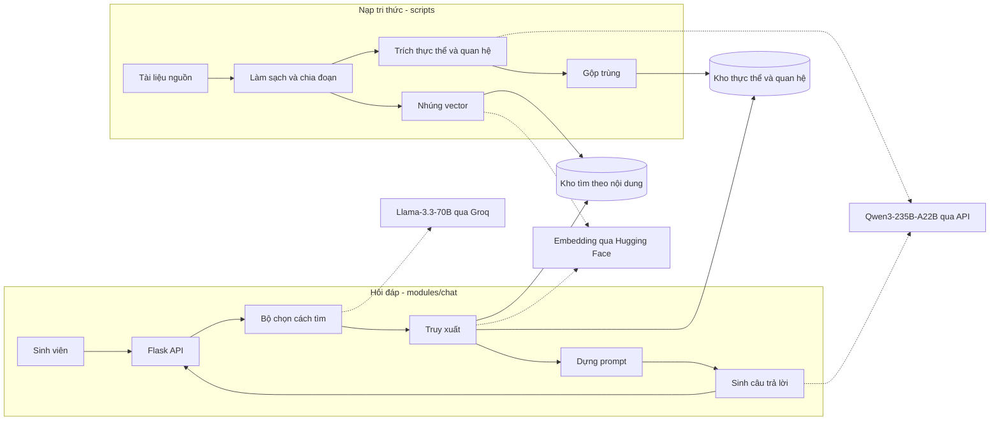

# Kiến trúc chatbot TLU

| Mục | Giá trị |
|-----|---------|
| Dự án | ChatBot (Trường Đại học Thủy Lợi) |
| Phiên bản | 1.0 - 2026-10-13 |
| Trạng thái | Nháp |
| Liên quan | `Plan-chatbot-tlu.md`, `./flows/QT-01-hoi-dap-sinh-vien.md`, `./flows/QT-02-cap-nhat-tri-thuc-chatbot.md` |

Ghi chú về nguồn: mỗi quyết định ở mục 5 được ghi kèm nguồn. "Đã chốt" nghĩa là có trong tài liệu luồng gốc. "Đề xuất" nghĩa là mình đề xuất và cần người yêu cầu xác nhận.

## 1. Tổng quan

Hệ thống có hai luồng chạy độc lập:

- **Luồng nạp tri thức (offline):** quản trị viên dữ liệu đưa tài liệu của trường vào. Hệ thống làm sạch, chia đoạn, và lưu vào hai kho. Chạy theo đợt, không phục vụ người dùng.
- **Luồng hỏi đáp (online):** sinh viên gửi câu hỏi qua giao diện web. Hệ thống chọn cách tìm, truy xuất từ hai kho, và sinh câu trả lời. Chạy mỗi khi có câu hỏi.

Hai luồng gặp nhau ở hai kho tri thức. Luồng nạp ghi, luồng hỏi đáp đọc.

## 2. Sơ đồ thành phần

## 3. Cấu trúc module

Dự án theo kiểu modulith, cấu trúc hiện tại gồm `src/modules/` (auth, chat, user), `src/platform/` (logging, security), `src/shared/` (common, config, database, events), `scripts/`, và `tests/` (e2e, integration, unit).

Quy ước của dự án, lấy từ module `user`:

- Mỗi module chia 4 lớp: `api`, `application`, `domain`, `infrastructure`.
- Module không import trực tiếp lớp bên trong module khác.

Phân bổ đề xuất cho chatbot:

| Thành phần | Vị trí | Nội dung |
|------------|--------|----------|
| API | `modules/chat/api/` | Route Flask: gửi câu hỏi, lấy lịch sử |
| Ứng dụng | `modules/chat/application/` | Bộ chọn cách tìm, truy xuất, dựng prompt, sinh câu trả lời, quản lý hội thoại |
| Miền | `modules/chat/domain/` | Cách tìm (Vector, Đồ thị, Kết hợp, Không truy xuất), quy tắc không có thông tin |
| Hạ tầng | `modules/chat/infrastructure/` | Client ChromaDB, Neo4j, Groq, Qwen, Hugging Face |
| Nạp tri thức | Đề xuất: `modules/chat/application/knowledge/` hoặc module `knowledge` riêng (xem P-03 trong kế hoạch) | Làm sạch, chia đoạn, trích thực thể, gộp trùng |
| Điểm vào nạp | `scripts/` | Lệnh chạy nạp thủ công |
| Cấu hình | `shared/config/` | Khóa API, địa chỉ kho, tham số |
| Log | `platform/logging/` | Ghi log có mức độ |

Quy tắc giao tiếp: luồng hỏi đáp chỉ đọc kho qua một cổng truy xuất. Cổng này do lớp `application` của `chat` định nghĩa, và `infrastructure` cài đặt.

## 4. Lưu trữ dữ liệu

### 4.1 Kho tìm theo nội dung (ChromaDB)

- Lưu các đoạn văn bản đã chia (văn bản và khối từ bảng).
- Mỗi đoạn có vector 768 chiều từ `bkai-foundation-models/vietnamese-bi-encoder`.
- Metadata: tên tài liệu, loại tài liệu, tiêu đề mục (văn bản); tên sheet, tiêu đề cột (bảng).

### 4.2 Kho thực thể và quan hệ (Neo4j)

- Node: thực thể, có tên, mô tả, loại thực thể, và vector nhúng từ tên và mô tả.
- Cạnh: quan hệ có nguồn, đích, mô tả, độ tin cậy.
- Ghi bằng Cypher MERGE, nên chạy lại không tạo bản trùng.

### 4.3 Lịch sử hội thoại

- Chưa rõ nơi lưu, thời hạn, và cách xóa (Q-07 trong QT-01). Mục này cần quyết định trước khi làm Giai đoạn 3.

## 5. Quyết định kiến trúc

| Mã | Quyết định | Lý do | Nguồn |
|----|-----------|-------|-------|
| ADR-01 | Dùng hai kho, một cho đoạn văn bản và một cho đồ thị | Đoạn văn bản trả lời định nghĩa và quy định chi tiết. Đồ thị trả lời quan hệ và điều kiện tiên quyết | Đã chốt |
| ADR-02 | Router dùng Llama-3.3-70B qua Groq | Router chạy trước mọi bước, nên độ trễ thấp là quan trọng | Đã chốt |
| ADR-03 | Sinh câu trả lời dùng Qwen3-235B-A22B | Tài liệu nguồn dẫn benchmark tiếng Việt trong Qwen3 Technical Report, Bảng 33. Cần kiểm chứng lại trước khi cam kết | Đã chốt (cần kiểm chứng) |
| ADR-04 | Embedding dùng vietnamese-bi-encoder, giới hạn 256 token | Mô hình được chọn cho tiếng Việt | Đã chốt |
| ADR-05 | Truy xuất vector dùng MMR, 10 ứng viên, lấy 5 | Cân bằng giữa liên quan và đa dạng của các đoạn | Đã chốt |
| ADR-06 | Đồ thị chấm điểm bằng α·semantic + (1−α)·keyword, α ∈ [0.6, 0.8] | Ưu tiên ngữ nghĩa nhưng vẫn giữ từ khóa | Đã chốt |
| ADR-07 | Neo4j cập nhật gia tăng bằng MERGE, không dựng lại toàn bộ như GraphRAG Parquet | Có thể nạp thêm tài liệu mà không phải xây lại đồ thị | Đã chốt |
| ADR-08 | Khi router trả sai định dạng, dùng nhánh Vector | Hệ thống luôn có câu trả lời | Đã chốt |
| ADR-09 | Khi truy xuất không có kết quả phù hợp, không gọi mô hình sinh câu trả lời, trả thông báo cố định | Tránh mô hình tự bịa khi thiếu tài liệu | Đề xuất (người yêu cầu đã chọn "nói không có thông tin" ở QT-01, nhưng cách kỹ thuật là đề xuất) |
| ADR-10 | Ngưỡng điểm để quyết định "không có thông tin" | Cần để thực hiện ADR-09 | Đề xuất, giá trị chưa xác định |
| ADR-11 | Khử trùng lặp hai giai đoạn: tên chính xác, rồi cosine ≥ 0.92 | Gộp các mục trùng nghĩa nhưng khác cách viết | Đã chốt |

## 6. Tích hợp bên ngoài

| Dịch vụ | Dùng cho | Khi lỗi |
|---------|----------|---------|
| Groq (Llama-3.3-70B) | Router, xác định loại thực thể, trích thực thể từ câu hỏi | Chưa rõ (Q-04 trong QT-01) |
| Qwen3-235B-A22B (API) | Trích thực thể và quan hệ khi nạp, sinh câu trả lời khi hỏi đáp | Chưa rõ (Q-04 trong QT-01) |
| Hugging Face (embedding) | Nhúng đoạn văn bản và câu hỏi | Chưa rõ |

Quy tắc chung đề xuất: thử lại có giới hạn, thời gian chờ cố định, khóa API chỉ đọc từ biến môi trường, không ghi vào log.

## 7. Triển khai

Chưa rõ:

- Chạy trên máy nào, và có máy chủ riêng không (P-06 trong kế hoạch).
- Cách đóng gói, ví dụ Docker. Trong dự án có `Dockerfile` trong danh sách phiên trước, nhưng chưa xác minh.
- Cách chạy ChromaDB và Neo4j, cùng máy hay tách riêng.

Đề xuất tối thiểu: cấu hình qua biến môi trường, không có khóa trong mã nguồn.

## 8. Ràng buộc và giới hạn đã biết

- `chunk_size = 800` có thể là token, nên vượt giới hạn 256 token của mô hình embedding (Q-12 trong QT-02). Cần làm rõ trước khi nạp dữ liệu thật.
- Quyết định nạp tri thức chạy thủ công, chưa có lịch tự động (GD-02 trong QT-02).
- Chưa có số liệu về độ trễ và chi phí API.

## 9. Câu hỏi mở

| Mã | Nội dung | Cần ai trả lời |
|----|----------|----------------|
| A-01 | Pipeline nạp nằm trong `chat` hay module `knowledge` riêng? | Người yêu cầu và đội kỹ thuật |
| A-02 | Lịch sử hội thoại lưu ở đâu? | Đội kỹ thuật |
| A-03 | Ngưỡng điểm truy xuất để quyết định không có thông tin là bao nhiêu? | Người yêu cầu và đội kỹ thuật |
| A-04 | Triển khai trên máy nào, có Docker không? | Đội kỹ thuật |
| A-05 | `chunk_size` là ký tự hay token? | Đội kỹ thuật |

## Lịch sử thay đổi

| Phiên bản | Ngày | Thay đổi |
|-----------|------|----------|
| 1.0 | 2026-10-13 | Tạo mới từ luồng chatbot TLU và cấu trúc dự án |