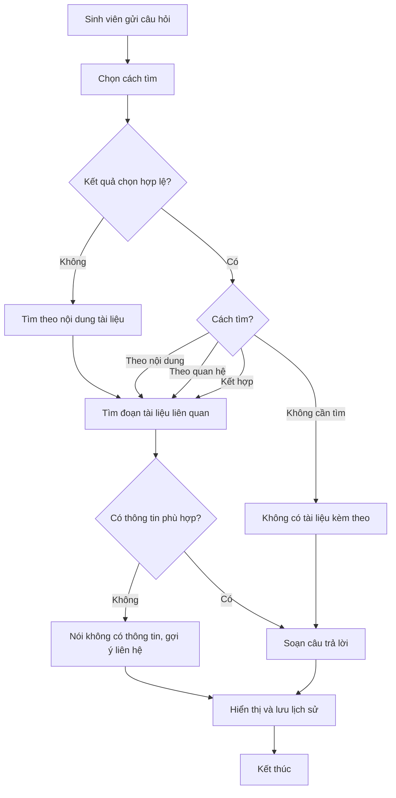

# [QT-01] Sinh viên hỏi đáp với chatbot TLU

| Mục | Giá trị |
|-----|---------|
| Dự án | Chatbot TLU (Trường Đại học Thủy Lợi) |
| Phiên bản | 1.1 - 2026-10-13 |
| Người yêu cầu | Chưa rõ (xem Q-01) |
| Ưu tiên | Chưa rõ (xem Q-02) |
| Loại | Mới |

## 1. Tóm tắt
Sinh viên đặt câu hỏi bằng tiếng Việt trên giao diện chatbot. Chatbot tìm thông tin trong tài liệu của trường rồi trả lời, có nhớ các câu hỏi trước trong cùng cuộc trò chuyện. Nếu tài liệu không có thông tin, chatbot nói rõ là không có và gợi ý liên hệ, không tự đoán.

## 2. Tác nhân & quyền
| Tác nhân | Vai trò hệ thống | Được làm gì trong quy trình |
|----------|-----------------|-----------------------------|
| Sinh viên | Sinh viên (chưa có khóa vai trò trong mã nguồn, xem GD-01) | Đặt câu hỏi, đọc câu trả lời, hỏi tiếp trong cùng cuộc trò chuyện |
| Hệ thống chatbot | Không phải người dùng | Phân loại câu hỏi, tìm tài liệu liên quan, soạn câu trả lời |

## 3. Điều kiện trước
- Tài liệu của trường đã được đưa vào hệ thống (QT-02 đã hoàn tất).
- Sinh viên đã đăng nhập vào chatbot (giả định, xem GD-01).
- Các dịch vụ xử lý ngôn ngữ đang hoạt động.

## 4. Luồng chính
| Bước | Ai | Hành động | Hệ thống xử lý | Kết quả người dùng thấy | Đã có / Mới |
|------|----|-----------|----------------|--------------------------|-------------|
| 1 | Sinh viên | Gõ câu hỏi và bấm gửi | Hệ thống nhận câu hỏi | Câu hỏi hiện trong khung trò chuyện | Mới |
| 2 | Hệ thống | Không có | Chọn cách tìm: theo nội dung tài liệu, theo mối quan hệ giữa các mục, kết hợp cả hai, hoặc không cần tìm (câu chào hỏi) | Không hiển thị | Mới |
| 3 | Hệ thống | Không có | Tìm các đoạn tài liệu liên quan nhất đến câu hỏi | Không hiển thị | Mới |
| 4 | Hệ thống | Không có | Ghép câu hỏi, quy tắc trả lời, thông tin tìm được và các câu hỏi trước trong cuộc trò chuyện | Không hiển thị | Mới |
| 5 | Hệ thống | Không có | Mô hình ngôn ngữ soạn câu trả lời bằng tiếng Việt | Không hiển thị | Mới |
| 6 | Hệ thống | Không có | Lưu lượt hỏi đáp vào lịch sử cuộc trò chuyện | Câu trả lời hiện trên màn hình | Mới |
| 7 | Sinh viên | Đọc câu trả lời, có thể hỏi tiếp | Quay lại bước 1 trong cùng cuộc trò chuyện | Lịch sử cuộc trò chuyện còn nguyên | Mới |

## 5. Sơ đồ

## 6. Luồng phụ & lỗi
| Mã | Tình huống | Hệ thống phản hồi | Thông báo cho người dùng |
|----|-----------|-------------------|--------------------------|
| E1 | Bước chọn cách tìm trả về kết quả sai định dạng hoặc không thuộc các cách đã định | Dùng cách tìm theo nội dung tài liệu | Không báo lỗi, trả lời bình thường |
| E2 | Tài liệu không có thông tin phù hợp với câu hỏi | Không tự soạn câu trả lời từ kiến thức chung | "Hiện chatbot chưa có thông tin về nội dung này. Bạn vui lòng liên hệ [đơn vị, Q-03]." |
| E3 | Câu hỏi để trống hoặc chỉ có ký tự đặc biệt | Không tìm kiếm | Yêu cầu nhập lại câu hỏi (cách hiển thị chưa rõ, GD-02) |
| E4 | Dịch vụ xử lý ngôn ngữ không phản hồi | Chưa rõ (Q-04) | Chưa rõ (Q-04) |
| E5 | Kho tài liệu không truy cập được | Chưa rõ (Q-04) | Chưa rõ (Q-04) |
| E6 | Câu hỏi không thuộc phạm vi trường (ví dụ chính trị) | Chưa rõ (Q-05) | Chưa rõ (Q-05) |
| E7 | Người chưa đăng nhập hoặc không phải sinh viên gửi câu hỏi | Từ chối, không trả lời | Yêu cầu đăng nhập bằng tài khoản sinh viên (thông báo chưa rõ, Q-09) |

## 7. Trạng thái
Không có vòng đời cho từng câu hỏi. Bỏ qua mục này.

## 8. Quy tắc nghiệp vụ
| Mã | Quy tắc |
|----|---------|
| BR-01 | Câu trả lời chỉ dựa trên thông tin tìm được trong tài liệu của trường. Không tự bịa thông tin. |
| BR-02 | Khi không có thông tin phù hợp, chatbot nói rõ là không có và gợi ý liên hệ, không trả lời theo kiến thức chung. (Người yêu cầu chọn phương án này, xem GD-03.) |
| BR-03 | Bước chọn cách tìm luôn có kết quả. Nếu kết quả sai định dạng, dùng cách tìm theo nội dung tài liệu. |
| BR-04 | Các câu hỏi trước trong cùng cuộc trò chuyện được đưa vào để hiểu các câu hỏi tiếp theo. |
| BR-05 | Câu trả lời luôn bằng tiếng Việt. |

## 9. Thông báo, realtime & nhật ký
| Sự kiện | Ai nhận | Kênh | Nội dung | Ghi audit? |
|---------|---------|------|----------|:----------:|
| Chatbot trả lời câu hỏi | Sinh viên đã hỏi | Giao diện chat | Câu trả lời | Chưa rõ (Q-06) |
| Chatbot không có thông tin | Sinh viên đã hỏi | Giao diện chat | Thông báo và gợi ý liên hệ | Chưa rõ (Q-06) |
| Lịch sử cuộc trò chuyện được ghi | Không có (hệ thống tự ghi) | Không có | Lượt hỏi đáp | Chưa rõ (Q-07) |

Tài liệu nguồn không mô tả thông báo realtime hoặc email.

## 10. Dữ liệu
| Thông tin | Bắt buộc | Ràng buộc | Ví dụ |
|-----------|----------|-----------|-------|
| Câu hỏi | Có | Tiếng Việt, không để trống | Chưa có ví dụ, cần bổ sung (Q-08) |
| Lịch sử cuộc trò chuyện | Không | Dùng cho các câu hỏi tiếp theo; thời hạn lưu và cách xóa chưa rõ (Q-07) | — |
| Câu trả lời | Có | Tiếng Việt, dựa trên thông tin tìm được | — |
| Cách tìm (nội bộ) | Có | Một trong 4 loại: theo nội dung, theo quan hệ, kết hợp, không cần tìm | — |

## 11. Màn hình liên quan
- Giao diện chat (các thành phần cụ thể chưa rõ, xem Q-08).

## 12. Tiêu chí nghiệm thu
- **AC-01**: Cho sinh viên đã đăng nhập / Khi hỏi một nội dung có trong tài liệu / Thì nhận câu trả lời tiếng Việt dựa trên tài liệu đó.
- **AC-02**: Cho sinh viên đã đăng nhập / Khi hỏi một nội dung không có trong tài liệu / Thì nhận thông báo không có thông tin kèm gợi ý liên hệ, không có câu trả lời bịa.
- **AC-03**: Cho bước chọn cách tìm trả về kết quả sai định dạng / Khi xử lý câu hỏi / Thì hệ thống vẫn trả lời, dùng cách tìm theo nội dung tài liệu.
- **AC-04**: Cho sinh viên vừa hỏi một câu / Khi hỏi tiếp bằng đại từ ("còn ngành đó thì sao?") / Thì câu trả lời dựa trên ngữ cảnh câu trước.
- **AC-05**: Cho người chưa đăng nhập hoặc không phải sinh viên (giả định GD-01) / Khi gửi câu hỏi / Thì bị từ chối và không nhận được câu trả lời.

## 13. Ảnh hưởng tới phần có sẵn
- Phụ thuộc QT-02: nếu tài liệu chưa được đưa vào hệ thống, chatbot không có gì để trả lời.

## 14. Giả định & câu hỏi mở
| Mã | Nội dung | Cần ai trả lời |
|----|----------|----------------|
| GD-01 | Chatbot chỉ dành cho sinh viên đăng nhập bằng tài khoản trường. Tài liệu không nói rõ. | Người yêu cầu (Q-09) |
| GD-02 | Câu hỏi để trống sẽ được yêu cầu nhập lại. Cách hiển thị chưa được mô tả. | Người yêu cầu |
| GD-03 | Khi thiếu thông tin, chatbot không dùng kiến thức chung. Người yêu cầu đã chọn phương án này. | Đã xác nhận |
| Q-01 | Ai yêu cầu đặc tả này và ai duyệt? | Người yêu cầu |
| Q-02 | Mức ưu tiên của quy trình này là gì? | Người yêu cầu |
| Q-03 | Gợi ý liên hệ nên ghi đơn vị nào (phòng công tác sinh viên, khoa, email, số điện thoại)? | Người yêu cầu |
| Q-04 | Khi dịch vụ xử lý ngôn ngữ hoặc kho tài liệu bị lỗi, sinh viên thấy gì và hệ thống làm gì? | Đội kỹ thuật |
| Q-05 | Câu hỏi ngoài phạm vi trường (không liên quan đến giáo dục) được xử lý thế nào? | Người yêu cầu |
| Q-06 | Có cần ghi nhật ký (audit) cho từng câu hỏi và câu trả lời không? | Người yêu cầu |
| Q-07 | Lịch sử cuộc trò chuyện lưu ở đâu, trong bao lâu, và sinh viên có xóa được không? | Đội kỹ thuật |
| Q-08 | Giao diện chat có những thành phần nào, và có ví dụ câu hỏi thực tế để bổ sung mục 10 không? | Người yêu cầu |
| Q-09 | Sinh viên có bắt buộc đăng nhập không? Thông báo khi chưa đăng nhập là gì? | Người yêu cầu |

## 15. Ghi chú kỹ thuật cho dev
- Không có mã nguồn trong phiên làm việc, nên chưa có `path:line` nào được xác minh.
- Bước chọn cách tìm dùng Llama-3.3-70B qua Groq, trả về JSON có 4 nhãn. Nếu sai định dạng, dùng nhãn Vector.
- Tìm theo nội dung: tìm vector, lấy 10 ứng viên (fetch_k = 10), chọn 5 đoạn bằng MMR (top_k = 5).
- Tìm theo quan hệ: trích thực thể bằng Llama-3.3-70B, tìm node theo từ khóa và theo ngữ nghĩa, điểm = α·semantic + (1−α)·keyword, α ∈ [0.6, 0.8], rồi lấy cạnh vào và ra của node được chọn.
- Soạn câu trả lời: Qwen3-235B-A22B qua API.
- Thành phần: Flask (giao diện), ChromaDB (vector), Neo4j (đồ thị).

## Lịch sử thay đổi
| Phiên bản | Ngày | Thay đổi |
|-----------|------|----------|
| 1.0 | 2026-10-13 | Tạo mới từ tài liệu luồng chatbot TLU |
| 1.1 | 2026-10-13 | Bỏ thuật ngữ kỹ thuật ở mục 1–4; AC phân quyền không còn điều kiện; thêm thông báo và audit cho thao tác ghi; bỏ ví dụ tự đặt; thêm E7 và GD-01 |