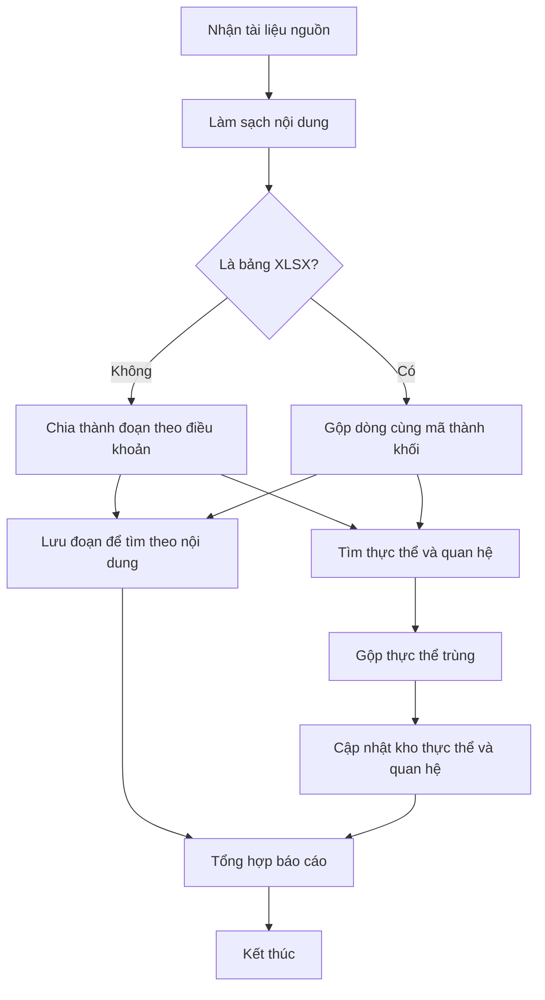

# [QT-02] Nạp và cập nhật tri thức cho chatbot TLU

| Mục           | Giá trị                               |
| ------------- | ------------------------------------- |
| Dự án         | Chatbot TLU (Trường Đại học Thủy Lợi) |
| Phiên bản     | 1.1 - 2026-10-13                      |
| Người yêu cầu | Chưa rõ (xem Q-01)                    |
| Ưu tiên       | Chưa rõ (xem Q-02)                    |
| Loại          | Mới                                   |

## 1. Tóm tắt

Quản trị viên dữ liệu đưa tài liệu của trường (trang web, file DOCX/PDF, bảng XLSX) vào hệ thống. Hệ thống làm sạch nội dung, chia nhỏ, rồi lưu thành hai kho: một kho để tìm theo nội dung và một kho lưu các thực thể và mối quan hệ giữa chúng. Chatbot dùng hai kho này để trả lời sinh viên (QT-01).

## 2. Tác nhân & quyền

| Tác nhân              | Vai trò hệ thống                                                       | Được làm gì trong quy trình                                     |
| --------------------- | ---------------------------------------------------------------------- | --------------------------------------------------------------- |
| Quản trị viên dữ liệu | Quản trị viên dữ liệu (chưa có khóa vai trò trong mã nguồn, xem GD-01) | Đưa tài liệu vào, chạy quy trình nạp, xem báo cáo               |
| Cán bộ phòng ban      | Cán bộ phòng ban (xem Q-03)                                            | Chưa rõ vai trò cụ thể trong quy trình                          |
| Hệ thống              | Không phải người dùng                                                  | Làm sạch, chia đoạn, lưu, tìm thực thể, gộp trùng, cập nhật kho |

## 3. Điều kiện trước

- Có tài liệu nguồn của trường (trang web, file DOCX/PDF, bảng XLSX).
- Hệ thống có quyền ghi vào hai kho tri thức.
- Dịch vụ xử lý ngôn ngữ đang hoạt động.

## 4. Luồng chính

| Bước | Ai                    | Hành động                       | Hệ thống xử lý                                                                                             | Kết quả người dùng thấy                            | Đã có / Mới |
| ---- | --------------------- | ------------------------------- | ---------------------------------------------------------------------------------------------------------- | -------------------------------------------------- | ----------- |
| 1    | Quản trị viên dữ liệu | Đưa tài liệu nguồn vào hệ thống | Nhận tài liệu và kiểm tra file có đọc được không                                                           | Danh sách tài liệu đã nhận, file lỗi được đánh dấu | Mới         |
| 2    | Hệ thống              | Không có                        | Làm sạch nội dung: bỏ khoảng trắng và ký tự thừa, bỏ tiêu đề và chân trang lặp; tách bảng thành file riêng | Không hiển thị                                     | Mới         |
| 3    | Hệ thống              | Không có                        | Chia văn bản thành đoạn theo điều khoản; với bảng, gộp các dòng cùng mã thành một khối                     | Không hiển thị                                     | Mới         |
| 4    | Hệ thống              | Không có                        | Lưu các đoạn để tìm theo nội dung                                                                          | Không hiển thị                                     | Mới         |
| 5    | Hệ thống              | Không có                        | Tìm các thực thể (ví dụ môn học, ngành, học phí) và mối quan hệ giữa chúng trong tài liệu                  | Không hiển thị                                     | Mới         |
| 6    | Hệ thống              | Không có                        | Gộp các thực thể trùng tên hoặc có nghĩa gần giống nhau                                                    | Không hiển thị                                     | Mới         |
| 7    | Hệ thống              | Không có                        | Cập nhật kho thực thể và quan hệ, không tạo bản ghi trùng                                                  | Không hiển thị                                     | Mới         |
| 8    | Quản trị viên dữ liệu | Xem báo cáo sau khi nạp (GD-04) | Tổng hợp số tài liệu, đoạn, thực thể, quan hệ, số lần gộp và số lỗi                                        | Báo cáo nạp                                        | Mới         |

## 5. Sơ đồ

## 6. Luồng phụ & lỗi

| Mã  | Tình huống                                               | Hệ thống phản hồi                                        | Thông báo cho người dùng                          |
| --- | -------------------------------------------------------- | -------------------------------------------------------- | ------------------------------------------------- |
| E1  | Tài liệu không đọc được (file hỏng, định dạng lạ)        | Bỏ qua file, ghi nhận lỗi                                | Tên file lỗi nằm trong báo cáo                    |
| E2  | Bảng XLSX có ô gộp hoặc dòng tổng cộng                   | Điền ô gộp từ ô phía trên, bỏ dòng tổng và chú thích     | Không báo lỗi (xử lý tự động)                     |
| E3  | Bước tìm thực thể trả về kết quả sai định dạng           | Chưa rõ (Q-05)                                           | Chưa rõ (Q-05)                                    |
| E4  | Hai thực thể trùng nhưng mô tả khác nhau                 | Giữ mô tả dài hơn, chuyển toàn bộ quan hệ về thực thể đó | Ghi nhận trong báo cáo                            |
| E5  | Ghi kho thất bại giữa chừng                              | Chưa rõ (Q-06)                                           | Chưa rõ (Q-06)                                    |
| E6  | Người không phải quản trị viên dữ liệu cố chạy quy trình | Từ chối, không đọc hay ghi dữ liệu nào                   | Thông báo không có quyền (nội dung chưa rõ, Q-07) |

## 7. Trạng thái

Không có vòng đời cho từng tài liệu trong yêu cầu gốc. Bỏ qua mục này. (Nếu cần theo dõi "đang nạp / đã nạp / lỗi", xem Q-08.)

## 8. Quy tắc nghiệp vụ

| Mã    | Quy tắc                                                                                                                                                  |
| ----- | -------------------------------------------------------------------------------------------------------------------------------------------------------- |
| BR-01 | Văn bản được chia theo điều khoản. Mỗi đoạn ghi kèm tên tài liệu, loại tài liệu, tiêu đề chương/mục.                                                     |
| BR-02 | Mỗi sheet của bảng là một nhóm đoạn riêng. Mỗi đoạn ghi kèm tên sheet và tiêu đề cột.                                                                    |
| BR-03 | Các dòng cùng mã định danh (khóa chính) của bảng được gộp thành một đoạn, để một đoạn mô tả đủ một thực thể.                                             |
| BR-04 | Thực thể trùng được gộp: giữ mô tả dài hơn, chuyển toàn bộ quan hệ về thực thể được giữ lại.                                                             |
| BR-05 | Quan hệ trùng (cùng nguồn và đích) chỉ giữ một bản, ưu tiên bản có nhiều thông tin và độ tin cậy cao hơn.                                                |
| BR-06 | Cập nhật là cộng dồn: chạy lại trên cùng tài liệu không tạo thực thể hoặc quan hệ trùng.                                                                 |
| BR-07 | Các loại thực thể ban đầu theo khảo sát: môn học, ngành học, học phí, học bổng, học kỳ, bộ môn, đối tượng, thủ tục. Danh sách có thể mở rộng (xem Q-09). |

## 9. Thông báo, realtime & nhật ký

| Sự kiện                            | Ai nhận                    | Kênh           | Nội dung                      |   Ghi audit?   |
| ---------------------------------- | -------------------------- | -------------- | ----------------------------- | :------------: |
| Đưa tài liệu vào                   | Không có                   | Không có       | —                             | Chưa rõ (Q-10) |
| Ghi đoạn vào kho tìm theo nội dung | Không có (hệ thống tự ghi) | Không có       | Số đoạn đã ghi                | Chưa rõ (Q-10) |
| Ghi thực thể và quan hệ vào kho    | Không có (hệ thống tự ghi) | Không có       | Số thực thể và quan hệ đã ghi | Chưa rõ (Q-10) |
| Hoàn tất một đợt nạp               | Quản trị viên dữ liệu      | Chưa rõ (Q-10) | Báo cáo số lượng và lỗi       | Chưa rõ (Q-10) |

Tài liệu nguồn không mô tả thông báo realtime hoặc email.

## 10. Dữ liệu

| Thông tin      | Bắt buộc | Ràng buộc                                                                                    | Ví dụ |
| -------------- | -------- | -------------------------------------------------------------------------------------------- | ----- |
| Tài liệu nguồn | Có       | DOCX, PDF, XLSX, hoặc trang web của trường                                                   | —     |
| Đoạn văn bản   | Tự động  | Kích thước 800, chồng lấn 120 (đơn vị chưa rõ, xem Q-12); có tên tài liệu, loại, tiêu đề mục | —     |
| Khối từ bảng   | Tự động  | Một khối cho một mã định danh; có tên sheet và tiêu đề cột                                   | —     |
| Thực thể       | Tự động  | Có tên, mô tả, loại thực thể                                                                 | —     |
| Quan hệ        | Tự động  | Có nguồn, đích, mô tả, độ tin cậy                                                            | —     |

## 11. Màn hình liên quan

- Chưa rõ có màn hình quản trị hay không. Quy trình có thể chạy bằng lệnh (xem Q-11).

## 12. Tiêu chí nghiệm thu

- **AC-01**: Cho một file PDF đọc được / Khi nạp / Thì mỗi đoạn có đủ tên tài liệu, loại tài liệu và tiêu đề mục.
- **AC-02**: Cho một bảng XLSX có ô gộp và dòng tổng / Khi nạp / Thì ô gộp được điền, dòng tổng bị bỏ, các dòng cùng mã thành một khối.
- **AC-03**: Cho hai thực thể trùng nhau về nghĩa nhưng tên khác / Khi gộp / Thì chỉ còn một thực thể, mô tả dài hơn được giữ lại.
- **AC-04**: Cho người không phải quản trị viên dữ liệu (giả định GD-01) / Khi cố chạy quy trình nạp / Thì bị từ chối, không có dữ liệu nào được đọc hay ghi.
- **AC-05**: Cho một đợt nạp đã chạy / Khi chạy lại trên cùng tài liệu / Thì không có thực thể hoặc quan hệ trùng nào được tạo thêm.

## 13. Ảnh hưởng tới phần có sẵn

- Là nguồn dữ liệu của QT-01. Nạp lại tài liệu sẽ thay đổi câu trả lời của chatbot.

## 14. Giả định & câu hỏi mở

| Mã    | Nội dung                                                                                                              | Cần ai trả lời       |
| ----- | --------------------------------------------------------------------------------------------------------------------- | -------------------- |
| GD-01 | Có vai trò quản trị viên dữ liệu và chỉ vai trò này được chạy quy trình nạp. Tên khóa vai trò chưa có trong mã nguồn. | Người yêu cầu (Q-07) |
| GD-02 | Quy trình do quản trị viên khởi động thủ công. Lịch chạy tự động chưa được nêu.                                       | Người yêu cầu        |
| GD-03 | Bước xác định các loại thực thể dùng Llama-3.3-70B trên 500 câu hỏi và chỉ chạy một lần, không chạy lại mỗi lần nạp.  | Đội kỹ thuật         |
| GD-04 | Sau khi nạp có báo cáo cho quản trị viên dữ liệu. Yêu cầu gốc không nêu.                                              | Người yêu cầu (Q-10) |
| Q-01  | Ai yêu cầu đặc tả này và ai duyệt?                                                                                    | Người yêu cầu        |
| Q-02  | Mức ưu tiên?                                                                                                          | Người yêu cầu        |
| Q-03  | Cán bộ phòng ban có tham gia quy trình nạp không, hay chỉ cung cấp tài liệu?                                          | Người yêu cầu        |
| Q-04  | Cán bộ phòng ban gửi tài liệu bằng cách nào (email, thư mục chung, tải lên)?                                          | Người yêu cầu        |
| Q-05  | Khi bước tìm thực thể trả về sai định dạng, xử lý thế nào (bỏ qua, thử lại, dừng)?                                    | Đội kỹ thuật         |
| Q-06  | Nếu ghi kho bị lỗi giữa chừng, có hoàn tác (rollback) không?                                                          | Đội kỹ thuật         |
| Q-07  | Có phân quyền cho việc chạy quy trình nạp không? Nếu có, người không có quyền thấy thông báo gì?                      | Người yêu cầu        |
| Q-08  | Có cần theo dõi trạng thái từng tài liệu (đang nạp, đã nạp, lỗi) không?                                               | Người yêu cầu        |
| Q-09  | Danh sách loại thực thể đã đầy đủ chưa, có cần thêm loại nào không?                                                   | Người yêu cầu        |
| Q-10  | Báo cáo sau khi nạp gửi đi đâu (màn hình, file nhật ký, email)? Có ghi audit các thao tác ghi không?                  | Người yêu cầu        |
| Q-11  | Quy trình chạy bằng lệnh, qua giao diện, hay cả hai?                                                                  | Đội kỹ thuật         |
| Q-12  | Kích thước 800 và chồng lấn 120 tính theo ký tự hay theo token?                                                       | Đội kỹ thuật         |

## 15. Ghi chú kỹ thuật cho dev

- Không có mã nguồn trong phiên làm việc, nên chưa có `path:line` nào được xác minh.
- Embedding: bkai-foundation-models/vietnamese-bi-encoder qua Hugging Face, 768 chiều, giới hạn 256 token.
- Chia đoạn văn bản: Recursive Character Chunking, chunk_size = 800, overlap = 120. Bảng: Group By Chunking theo sheet.
- Xác định loại thực thể: Llama-3.3-70B qua Groq (một lần). Trích thực thể và quan hệ: Qwen3-235B-A22B qua API.
- Khử trùng lặp hai giai đoạn: khớp tên chính xác, rồi khớp ngữ nghĩa với cosine ≥ 0.92.
- Lưu: ChromaDB cho đoạn văn bản, Neo4j cho đồ thị bằng Cypher MERGE (cập nhật gia tăng, khác GraphRAG Parquet tĩnh).
- Lưu ý Q-12: nếu 800 là token thì vượt giới hạn 256 token của mô hình embedding, đoạn sẽ bị cắt khi nhúng.

## Lịch sử thay đổi

| Phiên bản | Ngày       | Thay đổi                                                                                                                                               |
| --------- | ---------- | ------------------------------------------------------------------------------------------------------------------------------------------------------ |
| 1.0       | 2026-10-13 | Tạo mới từ tài liệu luồng chatbot TLU                                                                                                                  |
| 1.1       | 2026-10-13 | Bỏ thuật ngữ kỹ thuật ở mục 1–4; AC phân quyền không còn điều kiện; thêm thông báo và audit cho thao tác ghi; bỏ ví dụ tự đặt; thêm GD-01, GD-04, Q-12 |
